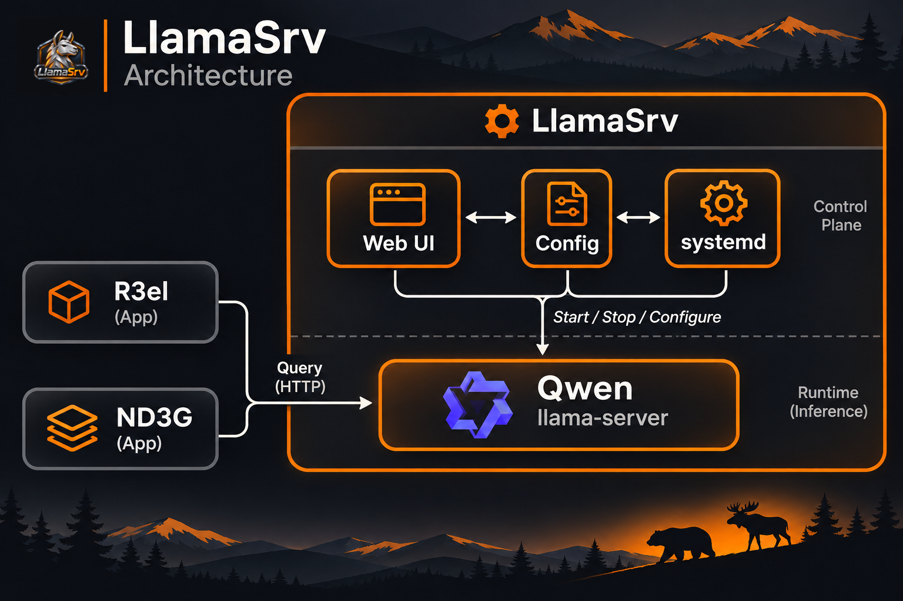
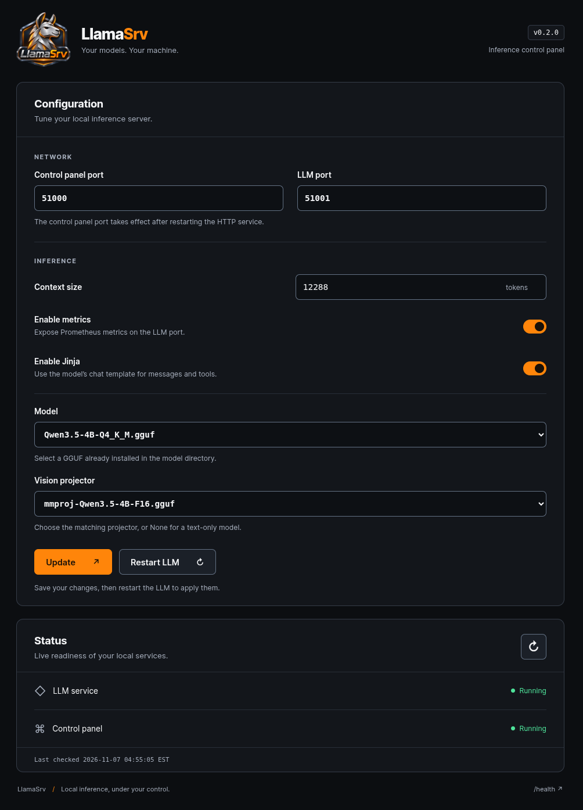

**LlamaSrv** runs [llama.cpp](https://github.com/ggml-org/llama.cpp) as a managed Linux service with a browser control panel. Applications such as R3el and ND3G can query one shared model endpoint without depending on one another.

The default setup runs Qwen3.5-4B with a vision projector.

| Component | Default port | Purpose |
| --- | --- | --- |
| Web control panel | `51000` | Configure, restart, and monitor inference |
| `llama-server` | `51001` | Handle inference requests from applications |

## Getting Started

- [Environment Setup]({{ site.baseurl }})

    1. [Prepare Linux]({{ site.baseurl }})
    2. [Build llama.cpp]({{ site.baseurl }})
    3. [Set up the Python venv]({{ site.baseurl }})
    4. [Download Qwen3.5-4B]({{ site.baseurl }})
    5. [Convert and install the model]({{ site.baseurl }})
    6. [Install and verify LlamaSrv]({{ site.baseurl }})

- [Qwen3.5-9B with Vision]({{ site.baseurl }}#qwen-35-9b)

    1. [Download Qwen3.5-9B]({{ site.baseurl }})
    2. [Convert and install the model]({{ site.baseurl }})
    3. [Install and verify LlamaSrv]({{ site.baseurl }})

- [Install LlamaSrv]({{ site.baseurl }})
- [Using LlamaSrv]({{ site.baseurl }})
- [Upgrade]({{ site.baseurl }})
- [Uninstall]({{ site.baseurl }})

## Additional Information

- [Project Structure]({{ site.baseurl }})
- [Changelog]({{ site.baseurl }})
- [Source repository](https://github.com/NadimGhaznavi/llamasrv)
- **LlamaSrv** is from the folks at [Bear & Moose](https://www.osoyalce.com)
